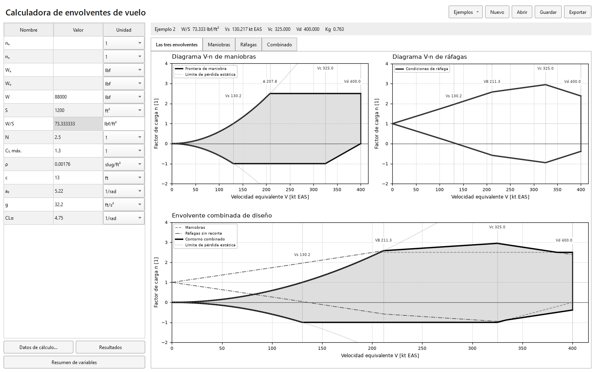

# Envolvente de Vuelo

Calculadora de escritorio en español para construir diagramas **V–n de maniobras, ráfagas y envolvente combinada**. Permite editar datos de una aeronave, recalcular las gráficas, guardar proyectos y exportar resultados. Desarrollada en Python con PySide6 y Matplotlib.



## Funciones

- Hoja de 14 filas con valores y unidades; carga alar calculada automáticamente.
- Cuatro vistas: **Las tres envolventes**, **Maniobras**, **Ráfagas** y **Combinado**.
- Ráfagas cuasiestáticas de Niu calculadas como `n = 1 ± Δn`, independientes de los límites de maniobra.
- Dos ejemplos reproducibles, coeficientes constantes o interpolación aerodinámica del caso del libro.
- Guardado en JSON con procedencia de parámetros, versiones y recuperaciones de edición.
- Exportación de tablas CSV, gráficas PNG/SVG y reportes PDF/DOCX.
- Interfaz y reportes en blanco, negro y grises; resumen integrado de variables.

## Ejecutar desde el código

Requiere **Windows y Python 3.12 de 64 bits**. Desde la raíz del repositorio, en PowerShell:

```powershell
python -m venv .venv
$env:PIP_CACHE_DIR = "$PWD\.runtime\pip-cache"
.\.venv\Scripts\python.exe -m pip install -r requirements-app.txt
.\.venv\Scripts\python.exe -B main.py
```

También puede utilizar `tools/lanzadores/Iniciar_aplicacion.cmd` una vez creado el entorno. La app funciona sin los libros PDF ni las fotografías originales. Guarda proyectos y resultados dentro de la carpeta del proyecto, que debe tener permisos de escritura.

## Ejecutable de Windows

En la instalación local existente, abra `Envolventes_de_Vuelo.exe` o `ABRIR_CALCULADORA_EXE.cmd`. **El EXE requiere su carpeta compañera `_internal/`**. El repositorio contiene el código para compilarlo; las dependencias instaladas y los binarios locales se conservan fuera del historial Git.

Para crear una distribución desde el código, consulte [Desarrollo y compilación](docs/DESARROLLO.md). El flujo manual [Compilar Windows](https://github.com/LuNsOGG/Envolvente-de-Vuelo/actions/workflows/compilar-windows.yml) prepara un artefacto descargable con la aplicación completa.

## Ejemplos incluidos

| Caso | Descripción | Datos principales |
|---|---|---|
| [Ejemplo 1](examples/ejemplo_1.json) | Ejercicio de la hoja Excel | W=4631 lbf, S=181 ft², N=3.8, CN+=1.46, CN−=−1.35 |
| [Ejemplo 2](examples/ejemplo_2.json) | Avión comercial genérico de Niu, §3.11 | W=88000 lbf, S=1200 ft², Vc=325 y Vd=400 kt EAS |

El coeficiente negativo −1.35 y las intensidades 50/25 ft/s del Ejemplo 1 son hipótesis editables. El Ejemplo 2 usa lecturas aproximadas e interpolaciones de figuras del libro. Consulte las [ecuaciones y supuestos](docs/METODOLOGIA.md) antes de reutilizarlos para otra aeronave.

## Documentación

| Documento | Contenido |
|---|---|
| [Índice](docs/README.md) | Ruta de lectura y documentación histórica |
| [Manual de uso](docs/USO.md) | Edición, ejemplos, guardado y exportación |
| [Metodología](docs/METODOLOGIA.md) | Ecuaciones, unidades, construcción de curvas y límites del modelo |
| [Arquitectura](docs/ARQUITECTURA.md) | Responsabilidad de módulos y flujo de datos |
| [Formato de proyectos](docs/FORMATO_PROYECTO.md) | JSON, procedencia, adaptación y resultados |
| [Desarrollo](docs/DESARROLLO.md) | Instalación, pruebas, compilación y herramientas |
| [Validación](docs/VALIDACION.md) | Referencias numéricas y evidencia de comprobaciones |
| [Organización](docs/ORGANIZACION.md) | Carpetas locales, contenido versionado y conservación |
| [Fuentes](docs/FUENTES.md) | Bibliografía, normativa histórica y documentos locales |
| [Cambios](CHANGELOG.md) | Evolución de las versiones |

## Organización

| Carpeta | Responsabilidad |
|---|---|
| `src/` | Cálculo, interfaz, gráficas y reportes |
| `tests/` | Pruebas de motores actuales e históricos |
| `examples/` | Proyectos reutilizables de los dos ejemplos actuales |
| `data/` | Proyecto histórico; recuperaciones locales excluidas de Git |
| `docs/` | Documentación vigente, referencias históricas y capturas |
| `tools/` | Lanzadores, pruebas, compilación y verificación |
| `.github/workflows/` | Pruebas en Windows y compilación manual |
| `sources/` | Material de referencia conservado localmente; bibliografía en `docs/FUENTES.md` |

## Pruebas

```powershell
.\.venv\Scripts\python.exe -m pip install -r requirements-dev.txt
.\.venv\Scripts\python.exe -B tools/run_tests.py
.\.venv\Scripts\python.exe -B main.py --comprobar
```

Las pruebas gráficas usan Qt sin pantalla. La validación numérica incluye ambos ejemplos, unidades, intersecciones, límites y persistencia. El estado de validación se documenta en [VALIDACION.md](docs/VALIDACION.md).

El alcance es académico y cuasiestático: no calcula resistencia estructural, flutter ni respuesta aeroelástica, y no acredita una envolvente operativa certificada. La normativa citada es histórica y su aplicabilidad depende de cada aeronave.

No se ha elegido una licencia de distribución para el código. La publicación del repositorio no concede por sí sola una licencia de uso de los materiales bibliográficos citados.
