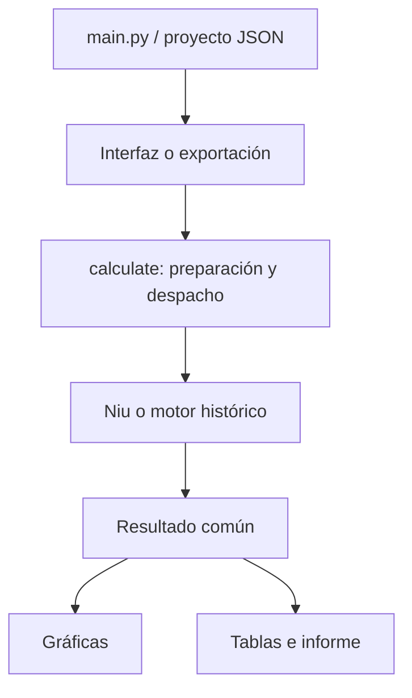

# Arquitectura

## Flujo de trabajo

`main.py` importa `bootstrap.py`, interpreta los argumentos y carga el proyecto. Sin opciones abre `WorksheetWindow`; en modo exportación utiliza el backend Agg. `bootstrap.py` determina la raíz, habilita paquetes locales cuando corresponde y dirige temporales y cachés a `.runtime/`.

La interfaz mantiene el proyecto y el caso activo. El despacho `calculate()` de `engine.py` adapta la hoja mediante `prepare_case()`, convierte unidades y llama al motor correspondiente. El resultado común alimenta gráficas, tablas y reportes; la interfaz no mantiene otra implementación de las ecuaciones.

## Módulos

| Ruta | Responsabilidad |
|---|---|
| `main.py` | Entrada de interfaz, exportación y comprobaciones |
| `bootstrap.py` | Raíz, rutas internas, recursos empaquetados y nombres nuevos |
| `src/project.py` | Validación, lectura y guardado versionado de JSON |
| `src/calculations/engine.py` | Catálogo de parámetros, despacho, resultados históricos y comparación |
| `src/calculations/niu.py` | Ráfagas, maniobra, tabla por Mach, VB, raíces y combinado actuales |
| `src/calculations/worksheet.py` | Catorce entradas, adaptación y derivaciones de la hoja |
| `src/calculations/examples.py` | Dos proyectos actuales y catálogo de variables |
| `src/calculations/thesis.py` | Condiciones Cessna, referencias publicadas, contraste y avisos de aplicabilidad |
| `src/calculations/cases.py` | Creación y duplicación de condiciones independientes |
| `src/calculations/units.py` | Conversión explícita y EAS/TAS |
| `src/ui/worksheet.py` | Interfaz vigente, menú Ejemplos, edición y recuperación |
| `src/ui/calculator.py`, `window.py` | Interfaces anteriores conservadas y probadas |
| `src/plotting/envelopes.py` | Figuras V–n y exportación PNG/SVG |
| `src/plotting/niu.py` | Catálogo histórico de diez dibujos explicativos |
| `src/calculations/appendix.py` | Preparación independiente de A3/A4 y lecturas documentadas |
| `src/ui/appendix_dialog.py`, `cover_dialog.py` | Procedimiento A3/A4 y edición de portada |
| `src/reporting/matlab_export.py`, `matlab_template.m` | Archivo MATLAB autónomo, entradas, motor y comprobaciones de referencia |
| `src/reporting/exporter.py` | Carpetas nuevas, tablas, resultados, figuras y reportes |
| `src/reporting/general_report.py` | Contenido de reportes actuales e hipótesis |
| `src/reporting/reports.py` | Render PDF/DOCX y reportes históricos |
| `src/niu_selfcheck.py` | Comprobación de ambos ejemplos, GUI y ejecutable |
| `src/selfcheck.py`, `worksheet_selfcheck.py` | Comprobaciones anteriores y redirección actual |

## Conservación y errores

Los cálculos de preparación trabajan con copias, para conservar la procedencia original. Las entradas inválidas producen `blocked` y curvas vacías. La interfaz retira el resultado anterior al detectar una condición inválida.

`inside()` impide leer y escribir proyectos fuera de la raíz autorizada. `fresh()` selecciona un nombre libre; no reemplaza por defecto los archivos de usuario. `save_project()` valida antes de escribir. Cada exportación crea un destino nuevo.

La interfaz programa el recálculo con un QTimer de disparo único de 550 ms; cada cambio confirmado reinicia la espera. Los cambios de condición y diálogos aceptados recalculan inmediatamente. La fuente DejaVu Sans incluida con Matplotlib permite mostrar texto y símbolos también en las comprobaciones Qt sin pantalla.

Las tablas del Ejemplo libro son constantes específicas de ese caso; no constituyen una base aerodinámica universal. Los modos históricos se conservan por compatibilidad. La vista vigente no presenta el contorno A4 histórico como una ráfaga física independiente.
