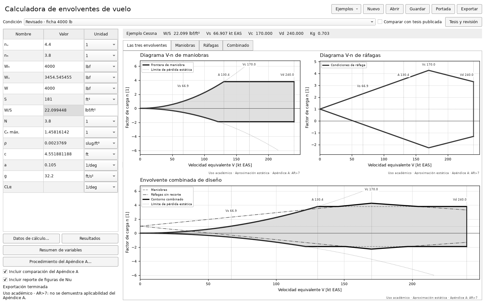

# Etapa 18–21 · entrega académica

Esta etapa implementa únicamente los puntos 18, 19, 20 y 21. Por indicación del usuario, los puntos **22, 23 y 24 quedan pendientes**. Se conserva el aviso existente sobre AR>7; no se amplía la evaluación de aplicabilidad ni se cambia la polar o el modelo cuasiestático.

| Punto | Implementación | Comprobación |
|---|---|---|
| [18](https://github.com/LuNsOGG/Envolvente-de-Vuelo/commit/3b0c099b1ed9899dfe5c66a9b12782a6be86cfaa) | Opción visible para exportar las diez figuras de Niu y su reporte PDF/DOCX | Archivos, índice de diez figuras y persistencia de la opción |
| [19](https://github.com/LuNsOGG/Envolvente-de-Vuelo/commit/858ead298c699f921946c9c55c9e1391c801d870) | Vista independiente A3/A4, n3/n4 con fuente y página, velocidades mínimas o seleccionadas y reporte separado | Lecturas independientes de Niu, guardado, cancelación y exportación |
| [20](https://github.com/LuNsOGG/Envolvente-de-Vuelo/commit/37f0360a8b35a5689691543bf480af466f15ce35) | Botón Portada para título, nombre, materia, docente y fecha; entregas identificadas con el nombre | Edición desde la interfaz, JSON y portadas PDF/DOCX |
| 21 | Archivo MATLAB editable con ecuaciones, tablas y gráficos de maniobra, ráfaga y combinado; A4 cuando está seleccionado | Entradas, fórmulas, referencias numéricas y análisis de sintaxis oficial |

## Uso

1. Seleccione **Ejemplo Cessna** o **Ejemplo libro** y complete los datos.
2. Complete la **Portada**. El nombre se usa en las portadas y en un nombre seguro para la carpeta de entrega.
3. En el Cessna, abra **Procedimiento del Apéndice A…** si desea revisar o cambiar las lecturas y sus fuentes. Las lecturas iniciales 3.8/-1.9 son las adoptadas por la tesis IPN; no son una lectura propia validada de los nomogramas.
4. Seleccione los reportes adicionales y pulse **Exportar**. La exportación conserva progreso y cancelación.

Se generan `reporte_analisis.pdf/docx`, los CSV/JSON y gráficos de la condición. Si están seleccionados, se agregan `reporte_figuras_niu.pdf/docx` con diez dibujos y `reporte_apendice_a.pdf/docx`, además de tablas y gráficos bajo `apendice_a/`.

## Archivo MATLAB

`calculos_envolvente.m` es autocontenido. Edite los bloques `cfg` y ejecute el archivo en MATLAB. Las unidades están indicadas junto a las entradas: peso como fuerza, velocidades EAS y pendientes por radián. Incluye interpolación del ejemplo del libro, S/b cuando corresponde y búsqueda de intersecciones; no reproduce las curvas copiando un CSV.

El script reserva un destino nuevo `resultados_matlab`, `resultados_matlab_2`, etc. Escribe tablas CSV, resultados JSON y PNG. La condición de referencia se comprueba con los resultados del motor original y muestra `REFERENCE_OK`; al editar entradas se omite esa comparación inicial, conservando las validaciones físicas.

La sintaxis se revisó con el analizador oficial de MATLAB R2025a. **La ejecución numérica nativa no pudo completarse en el entorno de trabajo: MATLAB encontró el error 5201 de comunicación con servicios MathWorks.** No se presenta una inspección de sintaxis como una ejecución numérica aprobada. La herramienta de escritorio y sus exportaciones se comprueban por separado.

## Alcance del procedimiento

A3/A4 es una comparación académica independiente. Los mínimos base, las velocidades elegidas, las intersecciones A/G y las lecturas n3/n4 se muestran por separado. A4 no es una curva física independiente de ráfaga. El aviso AR>7 permanece; la evaluación completa de aplicabilidad pertenece al punto 22 pendiente.

Fuente normativa histórica: [Apéndice A de FAR 23, edición 2016](https://www.govinfo.gov/content/pkg/CFR-2016-title14-vol1/pdf/CFR-2016-title14-vol1-part23-appA.pdf). Fuente de sintaxis MATLAB: [Funciones locales en scripts](https://www.mathworks.com/help/matlab/matlab_prog/local-functions-in-scripts.html).

Las pruebas específicas están en `tests/test_delivery_regressions.py`. Los registros detallados de ejecución, fuentes y distribuciones anteriores se conservan localmente.

## Comprobaciones de la versión 4.2

La suite completa aprobó **148 pruebas**. Cada uno de los cuatro cambios también aprobó sus pruebas en una copia aislada, con las versiones de los archivos que integran su commit.

El EXE instalado completó `--comprobar-gui` con salida 0 y exportó ambos ejemplos mediante la interfaz. Se verificaron las 1256 dependencias contra la distribución compilada y se conservaron juntos el EXE anterior y su carpeta `_internal/`. Los tres reportes PDF/DOCX se revisaron por integridad, portada y límites de página; se inspeccionaron páginas renderizadas.

Los archivos `.m` generados por el EXE pasaron MLint R2025a sin diagnósticos. La ejecución numérica en MATLAB continúa pendiente por el error 5201 descrito arriba. No se exporta un libro XLSX: la alternativa editable de esta etapa es MATLAB.

[Registro resumido de validación](correcciones_18_21_validacion.json). [Commits de la versión](https://github.com/LuNsOGG/Envolvente-de-Vuelo/commits/main/). [Pruebas remotas](https://github.com/LuNsOGG/Envolvente-de-Vuelo/actions/workflows/pruebas.yml).

